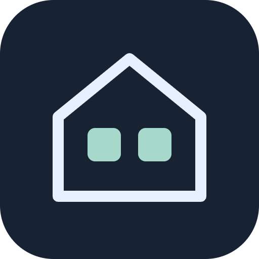
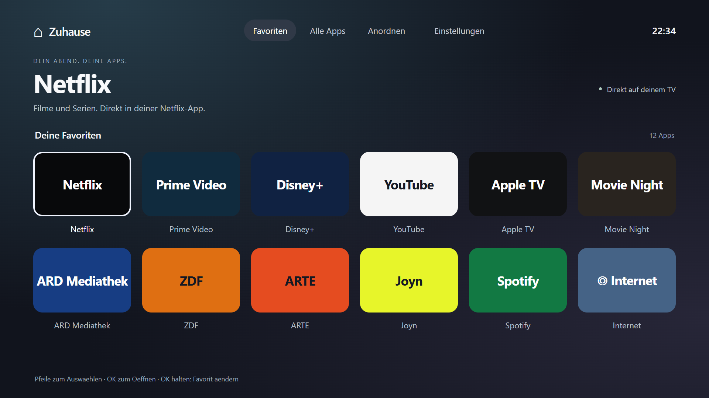
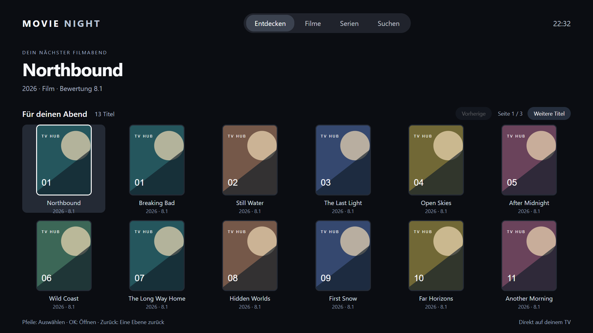

# Tizen TV Hub

A quieter, remote-first home screen and movie interface for Samsung Tizen TVs.
Built and physically tested on a **2020 Samsung Q60T, Tizen 5.5 / Chromium 69**.

 



**Two optional apps, installed directly on the TV:**

- **TVStart** opens your existing Netflix, Prime Video and other installed apps. Pin favorites, rearrange them, or enable the default fast mode.
- **Movie Night TV** provides a TV-sized catalogue, title details, series/episode picker and a consistent player. Browse paged movies, series or a mixed Discover view; choose a source, available resolution and audio track. Cinejoy's four providers have their own submenu; additional sources sit under Weitere Quellen. A [TV-local converter](docs/NATIVE-CONVERTER.md) lets supported Cinejoy streams use Samsung's native HD decoder.

After installation, neither app needs your PC to remain on. Movie Night needs an
internet connection and working third-party catalogue/stream services. TVStart's
interface and text tiles work offline; streaming apps still need their usual service.



Screenshots above are generated from the real interface with test fixtures. Catalogue
posters are synthetic illustrations; they do not show a user's accounts or watch history.

## Install on your TV

This is a **developer-sideloaded project**, not a Samsung Store download. A computer,
Tizen Studio and a Samsung TV signing certificate are needed for initial installation.
You sign packages for **your own TV**; this repository contains no signing keys or
universal pre-signed installer.

1. Follow [the installation guide](docs/INSTALL.md): install Samsung's SDK extensions,
   enable TV Developer Mode, connect your TV and create a certificate for its DUID.
2. Clone this repository. On Windows, from PowerShell:

   ```powershell
   git clone https://github.com/VictorMerk/tizen-tv-hub.git
   cd tizen-tv-hub
   py scripts/prepare-sites.py --esbuild PATH_TO_ESBUILD --wasm-opt PATH_TO_WASM_OPT
   .\scripts\build.ps1 -Profile "YourCertificateProfile"
   ```

   Prepare esbuild and Binaryen first; see [site-client setup](docs/SITE-CLIENTS.md). Generated service clients are built locally and are not stored in this repository.

3. Install the signed packages using Device Manager or explicitly target your TV:

   ```powershell
   .\scripts\build.ps1 -Profile "YourCertificateProfile" -Deploy -Device "YOUR_DEVICE_SERIAL"
   ```

Use `-Target launcher` or `-Target cinema` to build only one app. Pass
`-TizenStudio` if your SDK is not at the default location. Never clear Smart Hub or
reset a streaming app to install this project; existing streaming accounts are separate.

## Remote controls

| Where | Controls |
| --- | --- |
| TVStart | Arrows to move; OK to open; hold OK to pin/unpin; Anordnen to reorder |
| Catalogue | Arrows to browse; OK for details; Weitere Titel / Vorherige to change page |
| Last catalogue row | Down moves to Weitere Titel when another page exists |
| Player | OK activates the focused control; arrows select pause, seek, source, quality, audio or Back |
| Back | Closes the current dialog, player or detail page; details return to the same catalogue page |

The current interface is in German. Up to 20 movies or 20 series appear per page;
Discover interleaves both, up to 40 unique titles. The upstream catalogue currently
reports up to 500 pages. Only one page's tiles are rendered at a time.

## Picture quality

The default preference is **1080p**, retained across films, provider changes and app restarts. If a source lacks it, playback uses an available rendition; the overlay reports the actual decoded picture separately from the requested quality. Choose **Automatisch** to allow adaptive quality when a connection buffers.

The player lists **resolutions actually supplied by the source**. Auto is adaptive
quality when a source has multiple variants; it cannot create a missing 1080p or 4K
stream. The menu reports current picture dimensions and offers **Andere Quelle
vergleichen** when another source may look better. A 1920×1080 frame can still look
soft because of compression, mastering or upscaling in the supplied video. The quality panel separates the advertised bitrate from an approximate measured segment rate when available. Neither is a visual-quality score.

Samsung AVPlay and a simple browser video surface with local HLS.js provide two
playback paths. VidRift HD uses the normal Atlas provider option with H.264; VidRift Alternativ retains the previous automatic provider path. Both use the browser decoder. Native preparation failures
can fall back to the browser. Provider and decoder fallback are bounded and cancellable.

## What this changes—and its limits

- Installs ordinary TV apps. It does not replace Samsung firmware or the Home button,
  clean system RAM, unlock codecs, or independently upgrade the browser engine.
- Autorun Last App is Samsung's own setting. Netflix may resume if used last. Return
  to TVStart before switching off if you want it to be the last app; startup eligibility
  depends on the TV/firmware. Fixed boot-to-launcher has not been established.
- Only the Q60T/Tizen 5.5 has physical playback verification. Other models are unverified.
  Known app IDs and native utility panels can differ by country/model.
- Catalogue/provider availability, subtitle support, audio and quality depend on the
  source. No guarantee covers every title, a complete film or all providers.
- No website ad scripts, provider popup frames or desktop page are loaded. Ads embedded
  in a video stream are outside the app's control.
- Public third-party APIs may change. No authorization, DRM, payment or regional
  restriction bypass is implemented. Use sources you are entitled to access.

See [compatibility and measured checks](docs/COMPATIBILITY.md),
[troubleshooting](docs/TROUBLESHOOTING.md) and [privacy/data flow](docs/PRIVACY.md).

## Develop and contribute

The runtime is plain JavaScript/CSS, targeting Chromium 69. There is no Node build step.
HLS.js 1.5.18 is bundled locally. Signing/package generation uses Samsung's SDK.

```sh
python -m pip install -r requirements-dev.txt
python -m playwright install chromium
python tools/tests/launcher.py
python tools/tests/night.py
python tools/tests/browser-decoder.py
python scripts/check-public.py
```

Tests use local route fixtures and mocked TV APIs; they require no TV, account, remote
service or running local web server. Set `CHROME_EXECUTABLE` to use an existing Chrome.
They check remote navigation, paging and page restoration, source/audio/quality controls,
decoder fallback, cancellation and episode progression. Physical TV checks remain necessary
for actual picture and sound. See [CONTRIBUTING.md](CONTRIBUTING.md).

Original project code is [MIT-licensed](LICENSE). HLS.js is Apache-2.0; its copyright
notice and license are retained. See [third-party notices](THIRD_PARTY_NOTICES.md).
This is an independent community project, not affiliated with Samsung, Apple, Netflix,
Amazon or the catalogue/source services. No movies or service credentials are included.

App icon artwork is original SVG, with checked-in PNGs for Tizen. To regenerate after editing `launcher/icon.svg` or `cinema/icon.svg`, run `python scripts/render-icons.py`.
